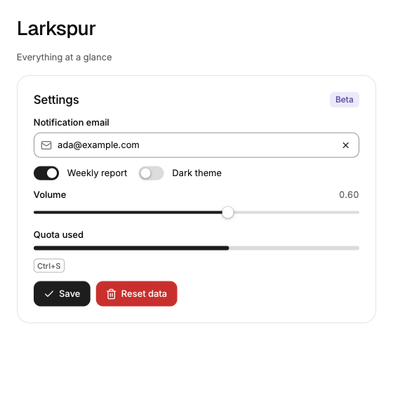
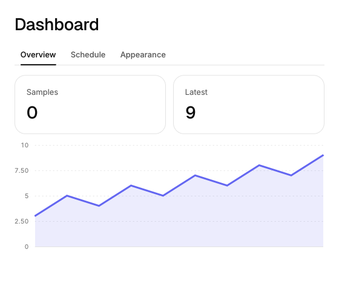

# glimmer-cui

A [glimmer](../glimmer) backend for [CUI](https://github.com/yappologistic/CUI):
reagent-style components and ratoms over CUI's native immediate-mode widgets.
It builds on [cui-jolt](../../jlt-commons/cui-jolt)'s binding.

```clojure
(ns hello
  (:require [glimmer.ratom :as r]
            [glimmer.core :as g]
            [glimmer-cui.core]))          ; installs the backend

(defn counter []
  (let [clicks (r/atom 0)]
    (fn []
      [:column {:pad 32 :gap 16}
       [:heading {:text "Hello, CUI" :level 2}]
       [:row {:gap 8}
        [:button {:label "Click me" :variant :primary :on-click #(swap! clicks inc)}]
        [:text {:text (str "Clicked " @clicks " times")}]]])))

(defn -main [& _] (g/run counter :title "Hello" :width 420 :height 300))
```



## Why

CUI is immediate-mode all the way down. Every frame it shows (input, hover,
animation, a caret blink) the whole UI has to be submitted again, and nothing
is retained between frames. cui-jolt maps that directly: your frame function
runs every frame, and every widget's options map is converted to a C struct
every frame.

glimmer-cui keeps the widget tree on the Jolt side and controls the
lifecycle:

- **Components re-render only when a ratom they read changes.** glimmer's
  reconciler patches the retained nodes, as it does for GTK.
- **Options are encoded once per props change.** A node's option struct and
  strings live in its own arena, so a frame encodes nothing.
- **A frame is a replay.** Each node holds a closure compiled when its props
  last changed, which calls CUI with pointers that are already built.
- **Out-parameters are node-owned cells.** A switch's `bool`, a slider's
  `float` and an input's text buffer persist across frames. A patch overwrites
  one only when the prop itself changed, so a re-render never clobbers input
  in progress.
- **Events fire after the walk.** Button returns and cell edits are collected
  during the replay and handled afterwards, so a handler's `swap!` never
  reshapes the tree mid-frame.
- **Each leaf gets its own CUI id scope** (`cui_push_id_int` with the node's
  serial). CUI's per-id state (focus, caret, animation) follows the node
  through keyed reorders, and two buttons with the same label don't collide.

## Tags

Every CUI component is a tag: 246 generated leaves, 37 generated containers,
and the hand-written protocols below. `jolt gen`
generates the table (`src/glimmer_cui/tags.clj`) from CUI's headers.
cui-jolt's `gen/gen.py` classifies each parameter, so a tag's props follow
the same rules as `cui.core`'s arguments. The tag is the C name minus `cui_`
and `_ex`, in kebab case: `cui_date_picker_ex` is `:date-picker` and the
`cui_dialog` scope is `:dialog`.

```clojure
[:tabs {:items ["Overview" "Schedule"] :index @tab :on-change #(reset! tab %)}]
[:line-chart {:series [{:name "Load" :values @samples}] :labels days :height 180}]
[:date-picker {:value {:year 2026 :month 11 :day 23} :on-change #(reset! due %)}]
[:toggle-group {:labels ["Mo" "Tu" "We"] :values [true false true] :on-change #(reset! days %)}]
[:sheet {:title "Settings" :open @open :on-close #(reset! open false)} ...]
```



**Props.** A positional C parameter becomes the prop with its name in kebab
case. Every other prop goes into the widget's CUI options struct, using
cui-jolt's conventions: keywords for enums and icons, `:fill`/`[:pct 50]`
sizes, colors as tokens or hex. An unknown option throws an error that lists
the valid ones. Bare strings render as `:text`.

- **Arrays** are collections. A `char **` plus its count is a vector of
  strings (`:items`). A struct array plus its count is a vector of maps
  (`:series`, `:steps`). Counts inside option structs are filled in, as in
  cui-jolt.
- **Out-parameters** are node-owned C cells, seeded from their prop: a
  scalar (`:index`), a struct as a map (`:value` of a date or color picker),
  an array from a vector (a toggle group's `:values`), or a text buffer
  (`:max-length` bytes, default 1024). A text buffer parameter named `buf`
  is the `:value` prop, as on `:input`. A patch overwrites a cell only when its
  prop changed, so a re-render never clobbers an edit in progress.
- **Editable arrays** (`kv-editor`, `curve-editor`, `query-builder`, …) take
  `pairs`/`keys` as a vector and get room for `:capacity` elements (default
  twice the count, at least 16). Rows the user adds come back in `:on-change`.
- **Atoms inside option structs**, such as `{:vote vote}` for
  `:response-actions` or `{:selected sel}` for `:commit-graph`, sync both
  ways. Each frame pushes an atom's change to C. After the walk, CUI's edits
  are written back to the atom.
- Inline `char[n]` fields (a kv pair's key) take and give strings as UTF-8.

**Events.**

| Handler | Fires |
|---|---|
| `:on-change v` | an out-parameter changed (CUI or the user edited it). With several, `:on-<prop>-change` (`:on-lo-change`, `:on-hour-change`) |
| `:on-close` | an `:open` cell went false (Escape, scrim, close button) |
| `:on-click` | a leaf or non-conditional container returned true (clicked, activated) |
| `:on-submit str` | a text field returned `CUI_SUBMITTED` |
| `:on-result v` | any other return (an int, an enum, a result struct as a map) differs from the previous frame's |

`:on-result` fires on each change, so a one-frame result such as a path
bar's `{:clicked 0}` fires again when it returns to `{:clicked -1}`.

**Id scopes.** A generated widget that takes an `id` gets its own CUI id
scope unless you pass `:id`. With an explicit `:id` it stays in its parent's
scope, so a CUI call naming that id can reach it, e.g.
`(gc/with-ui #(ui/popover-open % "pop"))` for `[:popover {:id "pop"} ...]`.
Leaves without an `id` parameter always get their own scope.

**Hand-written tags** take precedence where they read better: `:switch`
and `:checkbox` use `:checked`, and `:label`/`:secondary`/`:heading` use
`:label`/`:text`. They are `:column` `:row` `:box` `:card` `:scroll`
`:dialog` `:dialog-footer` `:text` `:badge` `:heading` `:label`
`:secondary` `:button` `:switch` `:checkbox` `:slider` `:input` `:progress`
`:spacer` `:separator`.

Toasts are actions, not components: show them with `with-ui`.

## Rows and protocols

Some CUI components don't fit begin, children, end. `glimmer-cui.protocols`
implements them as containers that replay themselves.

**Rows decided mid-frame.** A virtual list, data grid or tree table builds
only the rows in view, and only CUI knows which rows those are, once its
begin call has run. These tags take a `:row` function instead of children:

```clojure
[:data-grid {:columns [{:title "Name" :width 200} {:title "Email"}]
             :row-count (count @people) :selected sel   ; an atom of bools
             :on-row-click #(reset! current %)
             :row (fn [i]
                    (let [p (nth @people i)]
                      (list [:data-grid-cell-edit {:value (:name p)
                                                   :on-change #(swap! people assoc-in [i :name] %)}]
                            [:data-grid-cell-text {:text (:email p)}])))}]
```

Each frame the node asks CUI for the rows in view and mounts a glimmer
subtree for each row that came into view. It walks those rows and unmounts
the ones that scrolled away, so a 10,000-row list mounts about a screenful. A
row is an ordinary reactive component. It re-renders when a ratom it read
changes, or when the `:row` function changes. A row function returns one
element, a seq of them (wrapped in `:group`), or nil.

| Tag | Row function gets | Events |
|---|---|---|
| `:virtual-list` (`:count`, `:row-height`, `:height`) | the row index | |
| `:data-grid` (`:columns`, `:row-count`, `cui_grid_opts`) | the row index; cells are `:data-grid-cell-text`, `:data-grid-cell-edit`, or `:data-grid-cell` followed by components | `:on-row-click i` |
| `:tree-table` (`:columns`, `:nodes`, `cui_tree_table_opts`) | the node index; start with `:tree-table-name` | `:on-change nodes` (CUI set open or selected flags), `:on-expand`, `:on-collapse`, `:on-activate`, `:on-load [nodes]`, `:on-sort` |

**Structures that report at the end.** These take ordinary children:

| Tag | Children | Events |
|---|---|---|
| `:kanban` | `:kanban-column` (`:title`, `cui_kanban_column_opts`) holding `:kanban-card` (`:card-id`) | `:on-move {:card :from-column :to-column :to-index}`; a column's `:on-add`, a card's `:on-click` |
| `:reorder` | items, in display order | `:on-reorder order`: the new order as indices into the current one |
| `:swipe-item` (`:left`, `:right` actions) | the row content | `:on-action {:side :left :index 0}` |
| `:card-stack` (`cui_card_stack_opts`) | cards, the first on top | `:on-swipe :left` or `:right` |
| `:node-editor` (`:view`, `cui_node_editor_opts`) | `:node` (`:node-id`, `:x`, `:y`, `:title`) holding `:node-input`, `:node-output`, `:node-content`; and `:node-link` (`:link-id`, `:from-pin`, `:to-pin`) | `:on-link-create [from-pin to-pin]`, `:on-link-remove id`, `:on-node-delete id`, `:on-view-change`; a node's `:on-move {:x :y}` and `:on-select` |

Drops, links and deletions only report what the user did; you change your
data, as in CUI.

## Escape hatches

- **`(glimmer-cui.core/with-ui f)`** runs `(f ui)` once, inside the next
  frame, for things CUI exposes as actions rather than state: a toast,
  `set-theme`, `scroll-to`, focus. It can be called from any thread.
- **`[:cui/immediate {:render (fn [ui] ...)}]`** is an immediate-mode island.
  `render` runs every frame with the ui handle and a frame arena bound, so any
  `cui.core` call works there: a widget the tag table lacks, a terminal, a
  canvas. Its cost is per frame. A throw is reported and the frame goes on.
- **`:ref`** receives the node when it is created. `(glimmer-cui.core/rect
  node)` then gives its rectangle from the latest frame. Only nodes with a
  `:ref` pay for recording one.

## Threading and the wake patch

While the window loop runs, glimmer schedules re-renders onto it instead of
rendering inline. A `swap!` from an nREPL eval or a worker thread queues its
re-render for the next frame. If the loop is asleep waiting for input,
`cui_app_wake` wakes it. CUI had no cross-thread wake, so this repo carries
`patches/cui-app-wake.patch`. It adds `cui_app_wake(app)` with an
implementation per platform:

- X11: a self-pipe the wait selects on
- Win32: `PostMessage`
- Cocoa: an application-defined event
- GLFW: `glfwPostEmptyEvent`
- SDL2: `SDL_PushEvent`

It's a candidate to send upstream. Only the X11 path has been compiled and
exercised so far.

## Running

```sh
jolt native     # clone CUI a8f71c0, apply the wake patch, build native/libcui
jolt test       # headless suite: bare context, synthetic input, no display
jolt bench      # glimmer-cui vs cui-jolt direct mode, per frame
jolt floor      # the same UI from C
jolt shots      # render the examples to target/*.png with the software renderer
jolt gen        # regenerate the tag table from native/CUI (needs pycparser)
jolt -M:examples -m glimmer-cui.hello      # needs a display
jolt -M:examples -m glimmer-cui.settings   # needs a display
jolt -M:examples -m glimmer-cui.dashboard  # needs a display; a thread ticks the chart
```

`a8f71c0` is the CUI commit cui-jolt's bindings were generated from.

### Testing without a display

`glimmer-cui.headless` drives the same frame code as the window loop on a
bare CUI context (CUI's own embedding path, which needs no window):

```clojure
(def s (h/open {:width 420 :height 300}))
(h/mount! s [app])
(h/step! s 3)
(h/click! s (gc/rect @save-button))   ; move, press, release, one frame each
(h/type-text! s "hello")
(h/screenshot! s "target/app.png")    ; CUI's software rasterizer
(h/close! s)
```

While a session is open the backend counts as running, so re-renders are
scheduled exactly as in the window loop.

## Known limits

- An atom inside an option struct is encoded with its length when the
  widget's props last changed. Change a data grid's `:selected` vector
  together with `:row-count`, so the grid recompiles at the new size.
- `:on-result` fires on every change of a return value, including a
  one-frame result going back to "none".
